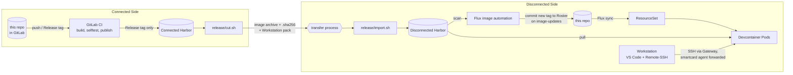

# k8scontainer

Each admin gets their own long-lived Devcontainer Pod on the Management Cluster, running one shared Standard Image. They reach it from a Windows Workstation with VS Code Remote-SSH, signing in with their smartcard. It is the Kubernetes-native successor to the Docker Host devcontainer (`camusicjunkie/devcontainer`).

This repository holds every piece of that: the image, the pipeline that builds it, the scripts that carry a Release across the air gap, the manifests Flux applies, the Workstation installer and the tests. Terms in **bold capitals** (Release, Roster, Site Config, ...) are defined in [`GLOSSARY.md`](GLOSSARY.md). Two ADRs record why it is shaped this way:

- [ADR 0001](docs/adr/0001-admins-reach-their-pod-over-sshd.md): admins reach their Pod over `sshd`, not `kubectl exec`, so the Workstation needs no Kubernetes access and the smartcard agent can be forwarded.
- [ADR 0002](docs/adr/0002-one-pod-per-admin-with-no-runtime-root.md): one long-lived Pod per admin, with no root at runtime, so the namespace can enforce Pod Security `restricted`.

## The whole picture

There are two networks. The **Connected Side** has Internet access and builds Releases. The **Disconnected Side** is air-gapped and only receives them. Each side has its own **Registry** (Harbor) and its own **Management Cluster**. The same Standard Image runs on both.



The Connected Side's Management Cluster runs the same Flux, Roster and Pods; the picture shows the Disconnected Side because that is the harder path.

Read it as four flows, each covered below:

1. **Build.** A commit becomes a tested image ([Standard Image](#1-the-standard-image), [CI pipeline](#2-the-ci-pipeline)).
2. **Release.** A tested image crosses the air gap unchanged ([Releases](#3-releases-across-the-air-gap)).
3. **Provision.** A Roster entry becomes a running Pod an admin can SSH into ([Management Cluster](#4-on-the-management-cluster), [Connecting](#5-how-an-admin-connects)).
4. **Update.** A new Release tag reaches each admin's Pod on their own schedule ([Image updates](#7-how-a-new-release-reaches-a-pod)).

## Repository layout

```text
image/                    the Standard Image
├── Dockerfile            multi-stage build; the final stage runs as dev (1000), no sudo
├── packages/             every pin and package list the build reads
├── build/                helper scripts used only during the build (brew, PowerShell)
└── rootfs/               files copied into the image as-is: commands, shell setup, self-test
.gitlab-ci.yml            build → selftest + checks → publish (Release tags only)
release/
├── cut.sh                Connected Side: Harbor image → archive + checksum + Review Packet
└── import.sh             Disconnected Side: archive → Harbor, with the digest unchanged
manifests/devcontainer/   what Flux applies on the Management Cluster
workstation/              the Windows installer and VS Code settings for the Workstation pack
tests/                    one script per seam; tests/all.sh runs them all
docs/                     admin guide, Release Owner guide, e2e checklist, ADRs
GLOSSARY.md               the domain language
CODING_STANDARDS.md       judgement calls for review (mechanical rules are checks instead)
.scratch/                 the spec and tickets this was built from, with their recorded answers
```

## 1. The Standard Image

[`image/Dockerfile`](image/Dockerfile) builds one image for every admin. It is based on Docker Hardened Images' Debian (`DHI_BASE`, pinned by digest). It runs as the non-root user `dev` (UID 1000) with no `sudo` and no setuid binaries, and nothing in it reaches the network at runtime.

### How it is built

Each stage does one job, and only its output reaches the final image:

| Stage | Produces | Reads |
|---|---|---|
| `brew`, `brew-check` | CLIs from Homebrew, kept only if they are static or need nothing but glibc ([`image/build/brew-check.sh`](image/build/brew-check.sh) fails the build otherwise) | `packages/brew.txt` |
| `hadolint`, `downloads` | hadolint, Codex, tflint, PowerShell, each checked against a pinned SHA-256 | `ARG`s in the Dockerfile |
| `python` | one venv at `/opt/venv` plus a wheelhouse for offline `pip install --no-index`, and the Ansible collections | `packages/python.txt`, `packages/ansible-collections.yml` |
| `caches` | mirrored Terraform providers, Packer plugins and PowerShell modules, so `terraform init` and the like work offline | `packages/terraform-providers.tf`, `packages/packer-plugins.pkr.hcl`, `packages/pwsh-modules.txt` |
| `vscode` | the VS Code server at one pinned commit, plus the baked-in extensions, under `/home/dev/.vscode-server` | `packages/vscode.env`, `packages/vscode-extensions.txt` |
| final | apt packages, the `dev` user, `rootfs/`, the trust-store link, and the Release MANIFEST at `/etc/devcontainer/release` (every tool and version in the image) | `packages/apt.txt` |

[`image/packages/vscode.env`](image/packages/vscode.env) is the single VS Code pin. The image bakes that commit's server, and the Workstation pack must carry the portable VS Code for the same commit. Remote-SSH refuses a mismatch and would try to download a server, which the Disconnected Side cannot do.

### What runs when the Pod starts

```text
devc-entrypoint                    refuses to run as root
  devc-ca-refresh                  public CA bundle + Site Config's ca/*.crt → /var/lib/devc/trust
                                   (/etc/ssl/certs/ca-certificates.crt links there)
  exec devc-sshd                   non-root sshd on 2222, in the foreground
    host key: /var/lib/devc/hostkeys/ssh_host_ed25519_key   (created once, kept on the volume)
    keys:     /etc/devc/authorized_keys                     (the Roster's key, mounted read-only)
    public key only, AllowUsers dev, agent and TCP forwarding allowed
```

| In `image/rootfs` | Role |
|---|---|
| `usr/local/bin/devc-entrypoint`, `devc-ca-refresh`, `devc-sshd`, `usr/local/lib/devc/sshd.bash` | start-up, above |
| `usr/local/bin/devc-ready` | the Pod's readiness probe: sshd's pid file names a live process |
| `usr/local/bin/secrets`, `with-secrets`, `devc-vault-pass`, `usr/local/lib/devc/secrets.bash` | the Secrets File ([section 6](#6-admin-state)) |
| `usr/local/bin/klogin`, `etc/bash.bashrc.d/50-klogin-completion.sh` | log in to vSphere Supervisors and Guest Clusters |
| `usr/local/bin/codex`, `etc/codex/config.toml` | wraps the Codex CLI so it talks only to the site's AI gateway, with only its key from the Secrets File |
| `etc/profile.d/20-config-env.sh` | loads Site Config's `site.env`, then Personal Config's `personal.env`, into every login shell |
| `etc/bash.bashrc.d/*` | interactive shells: `~/.local/bin` on `PATH`, completion, then Personal Config's `bashrc` last |
| `usr/local/bin/devc-selftest`, `usr/local/lib/devc/selftest.d/*` | the self-test: base tools, trust store, sshd, VS Code server and extensions, user tools, helpers, Codex, every tool in the MANIFEST, offline caches |

`devc-selftest` is the image's own definition of working. CI runs it with no network before anything is published, and `tests/image.sh` runs it locally.

## 2. The CI pipeline

[`.gitlab-ci.yml`](.gitlab-ci.yml) runs on the Connected Side's GitLab. It uses no privileged runner and no Docker daemon: buildah builds rootless and skopeo copies images.

```text
build       buildah build image/ → push $CI_REGISTRY_IMAGE/candidate:<sha>-<pipeline id>
├─ selftest buildah run --network none candidate -- devc-selftest
└─ checks   tests/all.sh --files   (no image needed; starts at once)
publish     only on tags vX.Y.Z / X.Y.Z, needs selftest + checks:
            skopeo copy candidate → $HARBOR_IMAGE:<tag>
```

`publish` copies the exact image that passed its self-test, so the Harbor tag has the same digest as the tested `candidate`. Every pipeline builds and tests, but only a Release tag publishes, and the Release Owner protects that tag pattern.

The pipeline needs these CI variables: `HARBOR_IMAGE`, `HARBOR_USER`, `HARBOR_PASSWORD` and, for the DHI base, `DHI_USER` and `DHI_PASSWORD`. The runner needs user namespaces and `/dev/fuse` (see the [Release Owner guide](docs/release-owner-guide.md)).

## 3. Releases across the air gap

A Release is one image archive plus its checksum. Two scripts move it, both using skopeo with `--preserve-digests`, so the digest the Connected Side built is the digest the Disconnected Side runs.

| Step | Script | What it guarantees |
|---|---|---|
| Cut (Connected) | [`release/cut.sh`](release/cut.sh) `harbor/…/standard:1.2.3 1.2.3 out/` | writes `devcontainer-1.2.3.oci.tar`, its `.sha256`, and a Review Packet (`review-1.2.3/SUMMARY.md`: digest, labels, source). Refuses a version that isn't `X.Y.Z` and fails rather than let the digest change. |
| Carry | your transfer process | the archive and `.sha256` are all an import needs. The Workstation pack ([section 5](#5-how-an-admin-connects)) and the Review Packet travel with them. |
| Import (Disconnected) | [`release/import.sh`](release/import.sh) `devcontainer-1.2.3.oci.tar harbor/…/standard:1.2.3` | checks the checksum first, refuses an existing tag (a version is never overwritten), copies, then confirms the Registry's digest equals the archive's. |

## 4. On the Management Cluster

Flux applies [`manifests/devcontainer/`](manifests/devcontainer/kustomization.yaml). Nothing per-admin is written by hand: the Roster is data, and a ResourceSet turns it into objects. Nothing network-specific is committed either: those values are Flux variables, filled from the network's runtime facts ([below](#runtime-facts)). The Devcontainer Namespace itself (Pod Security `restricted`) belongs to whoever syncs this directory, so it outlives a prune and keeps the admins' volumes.

| File | Object | Role |
|---|---|---|
| `site-config.yaml` | ConfigMap `site-config` | the network's Site Config, from runtime facts: `site.env` (`KLOGIN_SERVERS`, `KLOGIN_NAMESPACES`, `KLOGIN_CLUSTERS`, and `AI_GATEWAY_URL` where the site has one) and `site-ca.crt`. |
| `roster.yaml` | ResourceSetInputProvider `roster` (Static) | the Roster: the Standard Image every Pod runs, as `imageRepository` (the network's Registry, from runtime facts) and `imageTag` (the one value the image automation rewrites), `gatewayAddress` for the shared Gateway (from runtime facts; `none`, the default, lets the load balancer pick), an optional `storageClass` for every volume (left out, the cluster's default class), and the `admins` list (`name`, `port`, `publicKey`, optional `resources`). |
| `image-automation.yaml` | ImageRepository and ImagePolicy `devcontainer-standard` | scan the Registry every 5 minutes, trusting `harbor-ca` and logging in with `harbor-pull`, and pick the newest Release tag (`semver ">=0.1.0"`, never a pre-release). |
| `networkpolicy.yaml` | NetworkPolicy `devcontainer-pods` | SSH into a Pod only from the shared Gateway; egress to DNS and outside the cluster's Pod network, never to other Pods. |
| `resourceset.yaml` | ResourceSet `devcontainer` | renders everything below from the Roster. |

### What the ResourceSet generates

One Gateway for the whole Roster, then one set of objects per admin. Everything is named `devc-<name>` and selected by the label `devcontainer/admin=<name>`, so an admin's route can only reach that admin's Pod.

```text
Gateway devcontainer (gatewayClassName istio, one IP)
└── listener ssh-<name>   TCP :<port from the Roster>         one per admin
per admin:
  TCPRoute  devc-<name>-ssh         listener ssh-<name> → Service devc-<name>-ssh:2222
  Service   devc-<name>-ssh         ClusterIP, the route's backend
  Service   devc-<name>             headless, required by the StatefulSet
  ConfigMap devc-<name>-authorized-keys   the admin's smartcard public key
  StatefulSet devc-<name>           1 replica, updateStrategy OnDelete
  └── Pod devc-<name>-0             the Devcontainer Pod (image = Roster's imageRepository:imageTag)
      └── PVC state-devc-<name>-0   20Gi, the Roster's storageClass or the cluster default: the State Directory
```

The Pod runs as UID 1000 with all capabilities dropped, no privilege escalation, the `RuntimeDefault` seccomp setting and no ServiceAccount token. It has no Kubernetes API credentials.

**Adding** a Roster entry and merging it provisions all of the above. **Removing** an entry prunes everything the ResourceSet generated, which ends that admin's access with the merge. The PVC is created by the StatefulSet controller, not by Flux, so it stays behind on purpose: a mistaken merge never destroys an admin's state, and adding them back finds it. The Roster is one input set, so one bad entry (a duplicate port, a malformed key) stops rendering for every admin.

### How this repository reaches the cluster

The clusters' Flux setup lives in the Gitops repository (`camusicjunkie/Gitops`): its `clusters/management/devcontainer.yaml` ResourceSet owns the Devcontainer Namespace and holds the GitRepositories, the ImageUpdateAutomation and the Kustomization that syncs `manifests/devcontainer` with `postBuild.substituteFrom: flux-runtime-info`. [`tests/kind/flux.yaml`](tests/kind/flux.yaml) is a smaller working example of the same, with the test values in `postBuild.substitute`.

The automation must live in `devcontainer`, because an automation only applies ImagePolicies in its own namespace. It holds push credentials, which is why it isn't in this repository.

#### Runtime facts

Every network-specific value is a Flux variable that the syncing Kustomization substitutes from the network's runtime facts. The Gitops repository's bootstrap writes them into `flux-runtime-info`; [`tests/site/facts.env`](tests/site/facts.env) is the contract and holds the test values. `tests/repo.py` fails if a manifest uses a variable not listed there, and the Gitops sync, with strict substitution, fails if a variable without a default is missing.

| Variable | Used for | Gitops bootstrap variable |
|---|---|---|
| `HARBOR_REGISTRY`, `HARBOR_PROJECT` | the Roster's `imageRepository` and the ImageRepository: `<registry>/<project>/devcontainer/standard` | `harbor_registry`, `harbor_project` |
| `DEVCONTAINER_SITE_ENV_B64` | Site Config's `site.env`, base64 | `devcontainer_site_env` (a map) |
| `DEVCONTAINER_SITE_CA_B64` | Site Config's `site-ca.crt`, base64 | `devcontainer_site_ca` (default: `harbor_ca`) |
| `DEVCONTAINER_GATEWAY_ADDRESS` | the Roster's `gatewayAddress`; default `none` | `devcontainer_gateway_address` |
| `DEVCONTAINER_POD_CIDR` | the Pod network the NetworkPolicy keeps Pods from; default `192.168.0.0/16`, VKS's | `devcontainer_pod_cidr` |

Write a new one as a variable here, add it to `tests/site/facts.env` and this table, and add it to the Gitops repository's bootstrap in the same change.

What else the Gitops repository supplies on the Management Cluster:

- **No Kyverno.** The Management Cluster runs no Kyverno, so nothing rewrites images or copies Secrets: the Roster's `imageRepository` names the Registry directly, and the Gitops ResourceSet copies `harbor-pull` and `harbor-ca` into the Devcontainer Namespace and puts `harbor-pull` on its default ServiceAccount, which the Pods use. `tests/kind/up.sh` does the same, without Kyverno, so the live seam runs under the same admission as the cluster.
- **Istio** (`gatewayClassName: istio`, from the Gitops repository's `clusters/management/istio.yaml`) programs the Gateway: a gateway deployment behind one LoadBalancer IP that forwards each listener's TCP to its admin's Service. No mesh is needed; the Devcontainer Namespace does not join ambient or take sidecars. It needs Istio 1.31 or later, which reads TCPRoute at `v1` (GA in the Gateway API standard channel since v1.6.0); Istio 1.30 read only `v1alpha2`, which the standard channel no longer serves. The Gitops repository's `clusters/management/istio.yaml` installs it. `gateway-options.yaml` sets the `seccompProfile` that Pod Security `restricted` requires on the gateway Deployment Istio generates.

## 5. How an admin connects

```text
Workstation                      Management Cluster
VS Code (portable, pinned commit)
  Remote-SSH  "Host devcontainer"
    HostName <gateway>  Port <admin's port>  User dev  ForwardAgent yes
        │
        ▼
  Gateway listener ssh-<name> ─► TCPRoute ─► Service devc-<name>-ssh:2222 ─► Pod devc-<name>-0
                                                                              devc-sshd
                                                         accepts only the key in devc-<name>-authorized-keys
        ◄── Windows OpenSSH agent (smartcard keys) forwarded into the session
```

The Workstation never runs containers and needs neither `kubectl` nor the Dev Containers extension. [`workstation/install.ps1`](workstation/install.ps1) runs offline from the Release's Workstation pack. It:

- checks every file against the pack's `SHA256SUMS`;
- refuses a VS Code commit that differs from `vscode.env`;
- unpacks the portable VS Code and installs only Remote-SSH from its VSIX;
- writes the offline settings from [`workstation/settings.json`](workstation/settings.json);
- adds the `Host devcontainer` block to `~\.ssh\config`.

Rerunning it is safe, and `-From` carries settings forward from the previous Release's install. The VS Code server and extensions are already in the image, so attaching downloads nothing. The Release Owner assembles the pack by hand ([Release Owner guide](docs/release-owner-guide.md), step 4).

## 6. Admin state

The Pod's filesystem comes from the image and resets on every restart. Only the State Directory survives: one volume per admin, mounted at six paths. A Release refreshes everything else in the user area (the VS Code server, extensions, dotfiles) when the admin restarts.

| Path in the Pod | Holds | Comes from |
|---|---|---|
| `~/workspace` | the admin's work | volume |
| `~/.kube` | cluster logins from `klogin` | volume |
| `~/.secrets` | the Secrets File (`~/.secrets/vault`) | volume |
| `~/.devc/personal` | Personal Config: `personal.env`, `bashrc` | volume |
| `~/.local` | tools the admin installs themselves (`~/.local/bin` is on `PATH`) | volume |
| `/var/lib/devc/hostkeys` | the sshd host key, so it never changes | volume |
| `/etc/devc/authorized_keys` | the admin's public key | Roster, read-only |
| `/etc/devcontainer/site/site.env`, `/etc/devcontainer/site/ca/site-ca.crt` | Site Config | ConfigMap, read-only |

**Site Config vs Personal Config.** Site Config belongs to the network: its CAs and its Supervisor addresses. It is read-only and never carried between networks: on the Management Cluster it comes from the Gitops repository's bootstrap, and `manifests/devcontainer/site-config.yaml` is only the placeholder kind and the tests use. Personal Config belongs to the admin and never holds secrets. Login shells load `site.env`, then `personal.env`, so a personal value overrides the site's. CA changes take effect at the next Pod start, because `devc-ca-refresh` rebuilds the trust store only at start-up.

**The Secrets File** is an `ansible-vault` file whose password is never stored anywhere:

```text
secrets / with-secrets / devc-vault-pass
  require the forwarded agent (only a Remote-SSH session has it)
  ask the agent to sign a fixed challenge with the key named by DEVC_UNLOCK_KEY (in personal.env)
  password = sha256(signature)       RSA PIV Authentication key: the same signature every time
  ansible-vault decrypts ~/.secrets/vault with that password
```

`with-secrets -k NAME command` puts chosen values into one command's environment only. `klogin` uses it for `VSPHERE_USER` and `VSPHERE_PASSWORD`, and `codex` uses it for `AI_GATEWAY_KEY`. Without the smartcard agent nothing unlocks, and only that admin's card opens their file.

**Installing tools.** There is no root, so a missing tool goes in `~/.local/bin`, which survives restarts. Anything worth keeping goes into the next Release (ADR 0002).

## 7. How a new Release reaches a Pod

```text
release/import.sh pushes standard:1.2.4 to the Registry
ImageRepository devcontainer-standard     sees the tag on its next 5-minute scan
ImagePolicy     devcontainer-standard     selects 1.2.4 (semver >=0.1.0)
ImageUpdateAutomation (in the Gitops setup)
  rewrites the marked imageTag in roster.yaml   # {"$imagepolicy": "devcontainer:devcontainer-standard:tag"}
  commits it to the image-updates branch
someone merges image-updates               ← the rollout decision
Flux syncs, the ResourceSet re-renders      every StatefulSet template now names 1.2.4
updateStrategy OnDelete                     running Pods are NOT restarted
each admin deletes their Pod when ready     it comes back on 1.2.4 with the same volume
```

**Rollback:** narrow the ImagePolicy `range` to the earlier version and merge. Then merge the automation's resulting Roster change, and admins pick it up on restart. Editing the Roster's imageTag by hand doesn't stick, because the automation moves it forward again.

## 8. Values that must agree

Several values appear on more than one side. If they drift apart, the parts still build but no longer fit together:

| Value | Where it must match | What catches a mismatch |
|---|---|---|
| VS Code commit | `image/packages/vscode.env` ↔ the server baked into the image ↔ the Workstation pack's `release.json` and zip | the image build (server checksum) and `install.ps1` (refuses another commit or zip) |
| sshd port 2222 | `devc-sshd` ↔ the Dockerfile's `EXPOSE` ↔ the ResourceSet's `containerPort`, Services, TCPRoute and readiness probe (`devc-ready 2222`) ↔ the NetworkPolicy's ingress port | `tests/image.sh`, `tests/cluster_policy.py` |
| Runtime facts | every Flux variable in `manifests/` ↔ `tests/site/facts.env` ↔ the Gitops repository's bootstrap (`flux-runtime-info`) ↔ the README's "Runtime facts" table | `tests/repo.py`, `docs/check.sh`; strict substitution fails the sync on a missing one |
| Registry repository | the Roster's `imageRepository` ↔ the ImageRepository's `spec.image`, the same runtime facts | `tests/cluster_update.py`, `tests/cluster-live.sh` |
| Pod CIDR | the NetworkPolicy's egress `except` (`DEVCONTAINER_POD_CIDR`) ↔ the cluster's own Pod network | e2e checklist section 2 |
| Pod-side paths: State Directory mounts, `/etc/devc/authorized_keys`, `/etc/devcontainer/site/…` | the ResourceSet's `volumeMounts` ↔ every such path the image reads | `tests/repo.py` |
| Image marker | `roster.yaml`'s `$imagepolicy` comment ↔ the ImagePolicy `devcontainer/devcontainer-standard` | `docs/check.sh`, `tests/cluster-live.sh` |
| CI variable names | `.gitlab-ci.yml` ↔ the Release Owner guide | `docs/check.sh` |

## 9. Tests

Each script tests one **seam**, a place where parts meet. Run everything this machine can with:

```bash
tests/all.sh           # every seam whose tools are present; the rest are reported as SKIP
tests/all.sh --files   # the file checks only: what CI's `checks` job runs
```

| Seam | Checks | Needs |
|---|---|---|
| `tests/ci.py` | what the pipeline does per ref: build and test always, publish only on Release tags, only the tested image | Python + PyYAML |
| `tests/repo.py` | every Pod-side path the image reads is mounted or shipped; base images pinned by digest; glossary terms in comments; ticket hygiene | Python |
| `docs/check.sh` | docs use glossary terms, cite paths that exist, and state facts that match the code | bash |
| `tests/image.sh` | builds the image; runs `devc-selftest` with no network as `dev` | Docker |
| `tests/secrets-klogin.sh` | runs the image the way the Pod does and drives `secrets`, `with-secrets` and `klogin` over SSH with a software agent standing in for the smartcard | Docker |
| `tests/release.sh` | `cut.sh` then `import.sh` between two throwaway registries; digest preserved, overwrite and corruption refused | Docker |
| `tests/cluster.sh` | renders the ResourceSet from sample Rosters (`tests/rosters/`), validates the schemas and Pod Security `restricted`, and the update flow (`tests/cluster_policy.py`, `tests/cluster_update.py`) | Docker, kubectl, flux-operator CLI |
| `tests/cluster-live.sh` | on a real cluster set up as the Management Cluster is (no Kyverno; the pull secret on the default ServiceAccount): Pod admitted and answers SSH with the Roster's key, directly and through the Istio gateway on the admin's port, state survives restart, a new tag flows through the automation and push branch to the template but not the running Pod, and removing and re-adding an admin | the kind cluster from `tests/kind/up.sh` |
| `workstation/tests` | the installer's Pester tests | pwsh + Pester 5 |

[`tests/kind/up.sh`](tests/kind/up.sh) builds that kind cluster: Flux (with the image controllers), the Gateway API CRDs and Istio gateway-only from the Gitops repository's `clusters/management/`, and no Kyverno, as on the Management Cluster. With `GIT_URL` set, it also applies `tests/kind/flux.yaml`. kind has no LoadBalancer, so the live seam reaches the gateway's Service by port-forward.

What no automated seam can reach (a real Gateway under Istio, real Harbor, a real smartcard, the real Management Cluster) is the manual [`docs/e2e-checklist.md`](docs/e2e-checklist.md). It gates every Release on the Disconnected Side.

## Where to go next

| You are | Read |
|---|---|
| an admin with a Devcontainer Pod, or keeping the Roster | [`docs/admin-guide.md`](docs/admin-guide.md) |
| the Release Owner | [`docs/release-owner-guide.md`](docs/release-owner-guide.md) |
| proving a Release on the Disconnected Side | [`docs/e2e-checklist.md`](docs/e2e-checklist.md) |
| changing the code | [`AGENTS.md`](AGENTS.md), [`CODING_STANDARDS.md`](CODING_STANDARDS.md), and the spec under `.scratch/in-cluster-devcontainer/` |

## Known gaps

- `kubectl-vsphere` ships only from a Supervisor, so the build bakes it only when given `SUPERVISOR_HOST` and the zip's checksum (see the [Release Owner guide](docs/release-owner-guide.md)); without it, `klogin` cannot complete a login.
- No script builds the Workstation pack, and the Review Packet has no vulnerability scan, SBOM or changelog yet.
- The ResourceSet has no `serviceAccountName`.
- The Homebrew CLIs (`image/packages/brew.txt`) install at their latest version at build time, so two builds of one commit can differ. The Release MANIFEST records what each Release got.
- The volume's StorageClass and size are set once: a StatefulSet's claim template can't change (see the [admin guide](docs/admin-guide.md)).
- Anything marked **Unverified** in the guides has been tested only on kind or locally, never on the real Disconnected Side.
